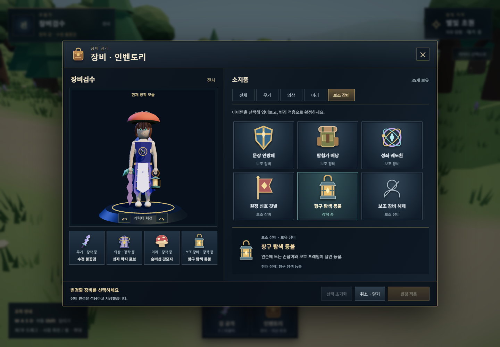
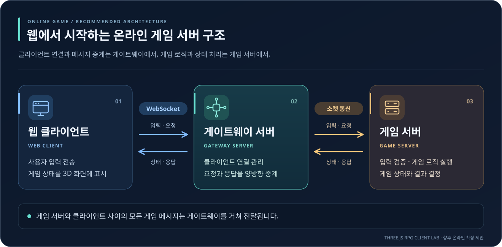

# Three.js RPG Client Lab

**웹 기술로 나만의 캐릭터를 만들고, 3D 필드를 걷고, RPG 클라이언트의 작동 원리를 익혀 보세요.**

TypeScript와 Three.js로 MMORPG 클라이언트의 구성 요소를 구현해 보는 실습·학습 프로젝트입니다.
캐릭터를 만드는 화면부터 장비를 바꾸는 순간까지, 게임 상태·3D 렌더링·입력·UI가 연결되는 과정을
실행 가능한 코드와 실제 플레이로 살펴볼 수 있습니다.

현재 실행 가능한 결과물은 **로컬 싱글플레이 판타지 RPG 프로토타입**입니다.
캐릭터 생성·선택, 3인칭 필드 이동, 인벤토리와 장비 교체, 검·지팡이·활의 공격 애니메이션을 제공합니다.
기본 게임에는 로그인·다른 플레이어·적 전투가 없습니다. 별도 로컬 네트워크 실습 모드에서
두 클라이언트의 서버 권한 이동, 예측·보간·재연결과 관심 영역을 실험할 수 있습니다.

## 이 프로젝트의 매력

- **직접 플레이하며 배우는 RPG 클라이언트:** 캐릭터 생성 → 필드 입장 → 이동 → 장비 교체 → 공격 애니메이션 → 저장 복원까지 하나의 흐름으로 경험합니다. 기능 하나를 바꾼 결과를 실제 게임 화면에서 확인할 수 있습니다.
- **HTML 하나로 전달하는 오프라인 데모:** 독립 실행 빌드를 만들면 코드·스타일·캐릭터 모델이 파일 하나에 담깁니다. 받는 사람은 별도 설치나 서버 없이 브라우저로 열어 체험할 수 있습니다.
- **프론트엔드 지식에서 출발하는 3D 개발:** Vite, TypeScript strict mode, Three.js와 DOM/CSS로 구성합니다. 익숙한 웹 UI와 이벤트 처리에서 게임 루프·좌표계·카메라·애니메이션으로 학습 범위를 넓힐 수 있습니다.
- **변경 경로를 따라가기 쉬운 구조:** 캐릭터·아이템 상태, 게임 로직, 렌더링, UI를 나눴습니다. 검 하나를 추가하며 소유권 검증부터 손 소켓 부착과 저장까지 데이터가 흐르는 경로를 익힐 수 있습니다.
- **705종의 시각 리소스를 탐색하는 갤러리:** NPC·동물·몬스터·장비·소품을 검색하고 미리 볼 수 있습니다. 갤러리도 단일 HTML로 빌드해 서버 없이 열 수 있습니다. 절차형 에셋 팩토리를 읽고 형태와 색을 바꾸는 실습 재료로 활용하세요. 갤러리의 모든 리소스가 기본 게임에 등장하는 것은 아닙니다.
- **네트워크와 성능을 눈으로 비교하는 실험 환경:** 별도 로컬 모드에서 두 클라이언트를 열어 지연·예측·재연결을 비교하고, 관심 반경·수신 빈도·부하 객체 수를 바꾸며 측정 결과를 살펴볼 수 있습니다.

## 이렇게 활용하세요

| 하고 싶은 일 | 추천 활용 방법 | 얻을 수 있는 결과 |
| --- | --- | --- |
| 설치 부담 없이 RPG 데모 체험·전달 | [독립 실행 HTML](#서버-없이-html-파일로-실행)을 빌드해 파일로 전달 | 인터넷 없이 캐릭터 생성·이동·장비 교체를 시연 |
| 웹 개발에서 3D 게임 개발로 입문 | [개발 서버](#개발-서버로-실행)를 켜고 카메라 거리와 공격 시간을 조정 | 코드 수정이 조작감과 화면에 미치는 영향을 확인 |
| 수업·스터디·개인 학습 과제로 사용 | [장비 추가 실습](docs/CLIENT_FLOW.md)을 따라 세 번째 검을 제작 | UI → 상태 검증 → 저장 → 렌더링의 전체 흐름을 설명하고 구현 |
| 캐릭터·장비·소품의 시각 표현 실험 | [에셋 갤러리와 Resource Editor](#개발-도구와-검사)에서 리소스와 부품 검수 | 팩토리 구조, 소켓, 크기와 배치 관계를 이해 |
| 온라인 클라이언트의 동기화 원리 학습 | [네트워크 A~E](docs/NETWORK_LAB.md)와 [성능 실험](docs/PERFORMANCE.md)을 순서대로 진행 | 지연·예측·보간의 차이와 전송량·표시 객체 수의 관계를 비교 |

처음이라면 기본 게임을 먼저 체험한 뒤 **검 하나 추가하기 → 공격 시간 바꾸기 → 두 창에서 네트워크 실험하기**
순서로 진행해 보세요. 작은 변경으로 시작해 클라이언트 전체의 연결 관계까지 학습할 수 있습니다.

## 화면

실제 로컬 실행 화면입니다. 캐릭터와 배경은 개발 중인 임시 아트입니다.


별빛 초원은 완만한 언덕과 낮은 골짜기, 굽이치는 흙길로 구성된 240×240m 필드입니다.
320그루의 활엽수·침엽수와 풀·야생화·관목 군락, 바위, 길가 룬석이 배치되어 있습니다.
캐릭터는 지형 높이에 맞춰 오르내리며, 카메라는 지형과 나무에 가릴 때 높이·거리를 보정합니다.
식생은 인스턴싱으로 묶어 렌더링합니다. 조작법은 아래와 같습니다.


### 추가 착용 아이템 30종



새 캐릭터와 기존 저장 캐릭터 모두 `I`를 눌러 새 아이템을 사용할 수 있습니다.
아이템 선택은 착장 미리보기이며 **변경 적용**을 누르면 필드와 저장에 반영됩니다.
색상만 바꾼 변형 대신 옷자락·견갑·장식·칼날·머리 장비의 윤곽을 각각 다르게 만들었습니다.

| 종류 | 추가 수 | 구성 |
| --- | ---: | --- |
| 의상 | 10 | 모래바람 유목복, 조류 선장 제복, 태엽 장인 작업복, 신사 수호 예복, 설원 파수꾼 외투, 버섯 채집가 복장, 하늘 우편 배달복, 흑요석 기사 갑주, 축제 무희 의상, 성좌 학자 로브 |
| 머리 장식 | 10 | 마녀 모자, 사슴 뿔관, 잠수 투구, 여우 가면, 불사조 깃장식, 터번, 확대경, 연꽃 보석관, 가부토, 버섯 갓모자 |
| 무기 | 5 | 세이버, 에스토크, 톱니 도살검, 쇼텔, 수정 불꽃검 |
| 보조 장비 | 5 | 문장 연방패, 탐험가 배낭, 성좌 궤도환, 원정 신호 깃발, 항구 탐색 등불 |

보조 장비는 별도 슬롯 한 곳에 착용하며 **보조 장비 해제**로 벗을 수 있습니다.
방패와 등불은 왼손, 배낭·고리·깃발은 등 소켓에 부착됩니다. 검은 베기 애니메이션을
사용합니다. 보조 장비는 외형용이며 방어력·피해량·새 전투 기술을 추가하지 않습니다.
갤러리의 아이템 탭에서 `착용 가능`을 검색하면 신규 30종을 따로 검수할 수 있습니다.

### 마법 지팡이와 활 각 10종

지팡이 10종과 활 10종은 새 캐릭터와 기존 저장 캐릭터 모두 인벤토리에서 선택할 수 있습니다.
무기마다 장식과 윤곽뿐 아니라 충전·발사·폭발과 잔상 표현도 다릅니다.
지팡이는 비전 룬, 초승달, 태양광, 덩굴, 얼음, 불꽃, 별궤도, 물결, 깃털, 톱니바퀴의 마법을 사용합니다.
활은 바람, 달빛, 숲의 잎, 태양날개, 서리, 기계 볼트, 독 나선, 번개, 장미 가시, 까마귀 깃털의 궤적을 표시합니다.
지팡이는 마법진과 함께 힘을 모아 시전하고, 활은 시위를 당겼다가 무기별 투사체를 발사합니다.
`I` → 무기 선택 → **변경 적용** → `F` 또는 짧은 좌클릭으로 확인하세요.
공격은 외형과 애니메이션을 체험하는 기능이며 적이나 피해량 계산은 없습니다.

## 실행

WebGL 2를 지원하는 데스크톱 브라우저가 필요합니다. 다음 두 방식으로 실행할 수 있습니다.

### 개발 서버로 실행

Node.js **22.14 이상(권장 24)**과 npm을 설치한 뒤 실행합니다.

```sh
npm ci
npm run dev
```

터미널에 표시된 주소(기본 `http://127.0.0.1:4173`)를 엽니다.
서버가 파일을 제공하고 소스 변경을 즉시 반영합니다. 기본 게임의 상태와 플레이는 브라우저에서 처리합니다.

### 서버 없이 HTML 파일로 실행

제작 PC에서 한 번 빌드합니다. 이 단계에는 Node.js와 npm이 필요합니다.

```sh
npm ci
npm run build:standalone
```

생성된 **`dist-standalone/index.html`을 더블클릭**하거나 Chrome에서 파일 열기로 선택합니다.
코드·스타일·캐릭터 모델이 HTML 하나에 포함됩니다. 이 파일을 다른 PC로 복사해도
**실행 시 Node.js, npm, 개발 서버, 인터넷 연결이 필요 없습니다.**
일반 `npm run build`로 만든 `dist/index.html`은 웹 서버 배포용이므로 이 파일과 구분하세요.
`dist/index.html`을 더블클릭했을 때 보이는 안내에서 **독립 실행 게임 열기**를 선택할 수도 있습니다.
웹 배포용 빌드를 확인하려면 `npm run build` 후 `npm run preview`를 실행하고 터미널의 주소를 여세요.

| 비교 | `npm run dev` | 기본 게임 독립 실행 HTML |
| --- | --- | --- |
| 실행 주소 | `http://127.0.0.1:4173` | 로컬 `file://…/index.html` |
| 실행 중 필요한 것 | Node.js와 실행 중인 개발 서버 | 브라우저와 HTML 파일 |
| 소스 수정 반영 | 저장하면 즉시 반영 | 다시 빌드한 HTML로 교체 |
| 기본 오프라인 RPG | 지원 | 지원 |
| 갤러리·리소스 편집·네트워크 실습 | 해당 개발 모드로 실행 가능 | 포함하지 않음 |
| 선택할 상황 | 코드 학습·수정·디버깅·개발 도구 사용 | 설치 없이 체험·전달·오프라인 플레이 |

코드를 수정하면서 학습할 때는 개발 서버를, 완성된 기본 클라이언트를 실행하기만 할 때는 독립 HTML을 선택하세요.
네트워크 A~E 실습은 로컬 서버와 통신하므로 `npm run dev:network`가 필요합니다.

### 에셋 갤러리를 서버 없이 열기

저장소에 포함된 **[docs/gallery.html](docs/gallery.html)을 더블클릭**하거나 Chrome의 파일 열기로 선택하세요.
별도 설치나 빌드 없이 바로 볼 수 있습니다.

소스나 리소스를 수정한 뒤에는 제작 PC에서 다음 명령으로 HTML을 갱신합니다.
의존성을 이미 설치했다면 `npm ci`는 생략할 수 있습니다.

```sh
npm ci
npm run build:gallery
```

생성되는 **`docs/gallery.html`은 Git으로 관리**합니다. 갤러리 소스를 변경하면 다시 빌드한 HTML도 함께 커밋하세요.
705종의 리소스, JavaScript·CSS·캐릭터 GLB가 HTML 하나에 포함되어 **서버와 인터넷 연결 없이**
카테고리 선택, 이름·ID·태그 검색, 3D 미리보기, 드래그 회전과 휠 확대를 사용할 수 있습니다.
WebGL 2를 지원하는 데스크톱 브라우저가 필요하며 Chrome에서 오프라인 실행을 검증했습니다.

다른 PC에는 `gallery.html` 한 개만 복사하면 됩니다. 받는 PC에는 Node.js나 npm이 필요 없습니다.
소스나 리소스를 수정한 뒤에는 `npm run build:gallery`로 다시 생성하세요.
게임용 `index.html`과 갤러리용 `gallery.html`은 각각 독립적으로 빌드되며 서로 덮어쓰지 않습니다.
리소스 편집과 네트워크 실습은 기존 개발 모드로 실행합니다.

### 시작과 조작

`캐릭터 생성 → 이름·체형·클래스 선택 → 생성 완료 → 필드 입장` 순서로 시작합니다.
전사는 검, 마법사는 지팡이, 궁수는 활로 시작합니다. 인벤토리에서 클래스와 관계없이
무기를 교체할 수 있으며, 장착한 무기에 맞춰 베기·마법 시전·활 발사 동작이 바뀝니다.
캐릭터와 장비는 해당 브라우저·주소의 `localStorage`에 저장됩니다. 개발 서버와 독립 HTML의 저장 데이터는 공유되지 않습니다.
독립 HTML은 Chrome에서 같은 파일 경로의 새로고침 복원을 검증했습니다. 파일 위치·브라우저를 바꾸거나
브라우저 데이터를 지우면 저장을 이어 쓰지 못할 수 있으므로 HTML 파일 자체에 저장 데이터가 들어 있다고 생각하면 안 됩니다.

| 조작 | 기능 |
| --- | --- |
| `WASD` / `Shift` + `WASD` | 이동 / 달리기 |
| 마우스 좌·우 버튼 드래그 / 휠 | 카메라 회전 / 거리 조절 |
| `I` / `Esc` | 인벤토리 열기·닫기 / 닫기 |
| 짧은 좌클릭 또는 `F` / 하단 공격 버튼 | 장착 무기의 공격 애니메이션 |
| HUD의 `캐릭터 선택` | 로비로 돌아가기 |

인벤토리는 **아이템 그림·이름이 있는 소지품 격자**와 **3D 캐릭터 착장 미리보기**를 함께 보여줍니다.
아이템을 선택하면 창 안의 캐릭터만 바뀌며, **변경 적용**을 눌러야 필드 장비와 저장에 반영됩니다.
`선택 초기화`로 현재 장착 모습으로 되돌릴 수 있습니다. `취소 · 닫기`, ×, 배경 클릭, `I` 또는 `Esc`로
닫으면 적용하지 않은 선택은 취소됩니다. 회전 버튼으로 착장을 다른 각도에서 볼 수 있습니다.
패널이 열린 동안 필드 이동·공격·카메라 입력은 멈춥니다.
짧은 좌클릭은 공격, 좌·우 드래그는 시점 회전으로 구분됩니다. 키를 놓으면 이동이 멈추며,
창 포커스를 잃거나 다른 탭으로 전환하면 진행 중인 입력을 취소합니다.
Ctrl·Alt·Meta 조합과 텍스트 입력은 게임 조작으로 처리하지 않습니다.
새로고침 후에는 로비에서 저장된 캐릭터로 다시 입장합니다. 로비의 캐릭터 삭제는 두 번 확인합니다.

### 첫 체험 추천 코스

1. 원하는 이름·체형·클래스로 캐릭터를 만들고 3D 미리보기를 확인합니다.
2. 필드에 입장해 `WASD`로 걷고, `Shift`로 달리며 마우스로 시점을 바꿉니다.
3. `I`로 인벤토리를 열어 **달빛 검·여행자 의상·초보자 모자**를 선택하고 착장 미리보기를 확인한 뒤 **변경 적용**을 누릅니다.
4. 인벤토리를 닫고 `F`를 눌러 교체한 검으로 공격 애니메이션을 실행합니다.
5. 페이지를 새로고침한 뒤 저장된 캐릭터로 다시 입장해 장비가 복원되는지 확인합니다.

## 코드에서 배울 수 있는 것

Vite + TypeScript strict mode + Three.js를 사용하며 UI는 DOM/CSS로 구성합니다.

| 경로 | 학습 주제 |
| --- | --- |
| `src/domain/` | 렌더러와 독립적인 캐릭터·아이템 상태, 장착 규칙, 저장 검증 |
| `src/game/` | 게임 루프, 입력, 카메라 기준 이동, 충돌, 공격 우선 애니메이션 |
| `src/render/` | 씬, 3인칭 카메라, 아바타, 이름 있는 소켓을 통한 장비 부착 |
| `src/ui/` | 캐릭터 화면, HUD, 인벤토리와 도메인 액션 연결 |
| `src/assets/` | 절차형 에셋 팩토리와 GLB 아바타 어댑터 |
| `tests/` | 도메인·렌더링 계약 단위 테스트와 브라우저 플레이 흐름 검증 |

읽기 순서와 작은 실습 과제는 [개발·학습 안내](docs/DEVELOPMENT.md)에 있습니다.
[장비 데이터 흐름과 실습](docs/CLIENT_FLOW.md), [네트워크 A~E](docs/NETWORK_LAB.md),
[성능 실험 결과](docs/PERFORMANCE.md)를 순서대로 따라갈 수 있습니다.

## 개발 도구와 검사

- **에셋 갤러리:** 저장소의 [docs/gallery.html](docs/gallery.html)을 열거나, 개발 서버의 `/?mode=gallery`로 접속합니다. NPC·동물·몬스터·장비·소품 등 705종의 시각 리소스를 검색합니다. 갤러리 리소스 전체가 플레이 가능한 콘텐츠는 아닙니다.
- **네트워크 실습:** `npm run dev:network`. 두 브라우저에서 지연·예측·재연결·관심 영역을 비교합니다.
- **로컬 Resource Editor:** `npm run dev:editor`. 리소스와 부품을 검수하는 선택적 개발 도구입니다. 연결·승인 흐름은 [개발 안내](docs/DEVELOPMENT.md#로컬-resource-editor)에 있습니다. 일반 플레이에는 필요하지 않습니다.

```sh
npm run lint
npm run test
npm run build
npm run test:e2e
```

E2E는 **설치된 Google Chrome**을 사용하며 로컬 테스트 서버를 시작합니다.
프로덕션 빌드는 `dist/`에 생성되며 기본 오프라인 게임만 포함합니다.
성능 반복 검사는 `npm run test:perf`, 루트·하위 경로 빌드 검사는 `npm run test:build`입니다.
독립 실행 검사는 `npm run build:standalone` 후 `npm run test:standalone`으로 수행합니다. 네트워크를 끈 Chrome에서 검사합니다.
갤러리 독립 실행 검사는 `npm run build:gallery` 후 `npm run test:gallery`로 수행합니다. HTML만 다른 폴더로 복사해 오프라인 검색·미리보기와 외부 요청 없음을 확인합니다.
로컬 검증과 배포 방법은 [공개 빌드 안내](docs/RELEASE.md)를 참고하세요.

## 범위와 라이선스

로컬 실습은 서버 권한·동기화의 기초를 다룹니다. 온라인 운영의 인증·보안 및 대규모 성능 검증은 후속 과제입니다.
캐릭터 아트와 애니메이션도 최종 품질이 아니며 모바일 조작은 지원하지 않습니다.

코드 라이선스는 [MIT](LICENSE)입니다. 에셋 제작 경로와 재생성 방법은 [에셋 안내](docs/ASSETS.md)를 참고하세요.
`docs/`에는 실행·학습·기술 참고 자료와 공개 데모용 갤러리를 제공합니다.

## 온라인 게임으로 확장한다면: 추천 서버 구조

온라인 게임을 만든다면 **웹 클라이언트 ↔ 게이트웨이 서버 ↔ 게임 서버** 구조를 추천합니다.
아래 그림은 향후 확장을 위한 제안이며, 현재 오프라인 게임이나 로컬 네트워크 실습에 구현된 구조는 아닙니다.



| 구성 요소 | 역할 | 통신 대상과 방식 |
| --- | --- | --- |
| 웹 클라이언트 | 사용자 입력을 보내고 전달받은 게임 상태를 화면에 표시 | 게이트웨이 서버와 WebSocket 통신 |
| 게이트웨이 서버 | 클라이언트 연결을 관리하고 요청과 응답을 양방향으로 중계 | 웹 클라이언트와 WebSocket, 게임 서버와 소켓 통신 |
| 게임 서버 | 입력을 검증하고 게임 로직을 실행해 상태와 결과를 결정 | 게이트웨이 서버를 통해 클라이언트와 통신 |

예를 들어 이동 입력은 `웹 클라이언트 → 게이트웨이 서버 → 게임 서버` 순서로 전달됩니다.
게임 서버가 계산한 위치는 `게임 서버 → 게이트웨이 서버 → 웹 클라이언트` 순서로 돌아와 화면에 반영됩니다.
웹 클라이언트의 접속 지점은 게이트웨이로 모으고, 게임 서버는 게임 로직과 상태 처리에 집중하도록 역할을 나눕니다.
