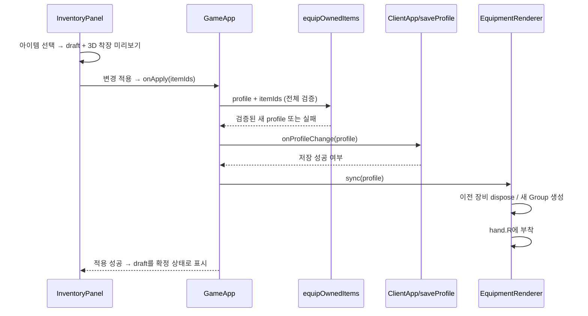

# 클라이언트 데이터 흐름과 실습

## 장비 버튼에서 손 소켓까지



미확정 선택은 InventoryPanel의 draft에만 존재한다. 닫으면 draft를 버리고, 적용할 때만 한 번 저장한다.
정본은 `CharacterProfile`이다. 메시나 DOM의 선택 색을 다시 읽어 장착 상태를 결정하지 않는다.
저장 실패 시 처리 순서는 `GameApp.handleApplyEquipment`를 따라 확인한다. 실패 메시지와 실제 저장 결과를 혼동하지 않는다.

## 프레임과 상태

`GameApp.renderFrame`은 delta를 최대 0.1초로 제한하고 입력→이동/충돌→애니메이션→카메라→렌더 순으로 실행한다.

이동 키는 keyup에서 즉시 해제하며 blur/숨김 상태에서는 이동·공격·드래그를 취소한다.
브라우저 단축키·IME·텍스트 편집 입력은 게임 키로 처리하지 않는다. 좌클릭과 카메라 드래그는
같은 6px 임계값으로 구분하고 우클릭 드래그도 시점 회전을 지원한다. 인벤토리는 필드의
이동·공격·카메라 입력을 함께 잠근다. 카메라는 원래 추적 위치와 장애물로 당겨진 최종 위치를
분리해 이동 방향을 유지하고 장애물이 사라지면 거리를 부드럽게 복구한다.
속도 6m/s라면 한 프레임의 이동 거리는 `6 * deltaSeconds`이다. 프레임당 고정 거리로 이동하면 120fps에서 30fps보다 네 배 빠르게 움직인다.
`tests/game/frameRate.test.ts`는 실제 이동 함수와 공격 타임라인을 30/60/120fps로 실행한다.
장시간 탭이 멈췄을 때 이 게임은 경과 시간을 따라잡는 대신 delta 상한으로 순간 이동을 방지한다.

Three.js의 +Y는 위다. 이동은 카메라의 시선 벡터를 XZ 평면에 투영하고 정규화한다.
대각선 입력도 길이를 1로 제한한다. 검 팩토리의 그립은 원점, 칼끝은 로컬 +Y이고, 장비 어댑터가 손 소켓의 회전에 맞춘다.
`attack_1` 활성 중에는 이동 키가 눌려도 공격 포즈를 유지한다. 종료한 다음 현재 입력에 따라 run/sprint/idle로 돌아간다.

## 실습 1: 세 번째 검 추가

별도 실습 브랜치에서 수행한다. 아래는 새 파일 `src/assets/equipment/createPracticeSword.ts`의 예다.

```ts
import { createTrainingSword } from "./createSword";

export function createPracticeSword() {
  const sword = createTrainingSword();
  sword.name = "weapon.practice-sword";
  sword.scale.set(1.3, 0.8, 1.3); // 원점/축은 유지하며 실루엣을 구별한다.
  return sword;
}
```

1. `src/domain/catalog.ts`의 ITEM_IDS에 `weapon.practice-sword`를 추가한다.
2. ITEM_CATALOG에 `{ id: "weapon.practice-sword", label: "실습용 검", slot: "weapon" }`을 추가한다.
3. getStartingOwnedItemIds의 반환 목록에 새 ID를 추가한다. 기존 저장에는 소유권이 없으므로 새 캐릭터로 확인한다.
4. `EquipmentRenderer.ts`에서 팩토리를 import하고 EQUIPMENT_VISUALS에 `{ itemId: "weapon.practice-sword", slot: "weapon", create: createPracticeSword }`를 등록한다.
5. 기존 equipment 단위 테스트 방식으로 소유 시 장착 성공, 미소유 시 거부를 검증한다. 런타임 소켓에 검이 한 개만 남는지 반복 교체한다.
6. 브라우저에서 새 캐릭터→교체→이동 중 공격→새로고침 복원을 확인한다. 스크린샷만으로 저장 복원을 판단하지 않는다.

갤러리 카탈로그에만 추가하면 게임 아이템이 되지 않는다. 이 구분을 설명할 수 있으면 실습을 이해한 것이다.

## 실습 2: 공격 지속 시간

`src/game/animationState.ts`의 ATTACK_DURATION_SECONDS를 0.72에서 1.0으로 바꾼다.
`tests/game/frameRate.test.ts`의 기대 시간을 함께 바꾸고, `tests/game/animationState.test.ts`에서 공격 우선순위 경계를 검토한다.
W를 누른 채 F를 누르고 공격이 끝나기 전 run으로 바뀌지 않는지 확인한다.
시각 타이밍과 이동 잠금은 서로 다른 값이므로 이동 잠금 시간을 무조건 같이 늘리지 않는다.

## 더 읽기

- [성능 실험](PERFORMANCE.md): 계측 방식과 실제 결과.
- [온라인 실습 A~E](NETWORK_LAB.md): 같은 상태/표현 분리를 네트워크 경계로 확장한다.
