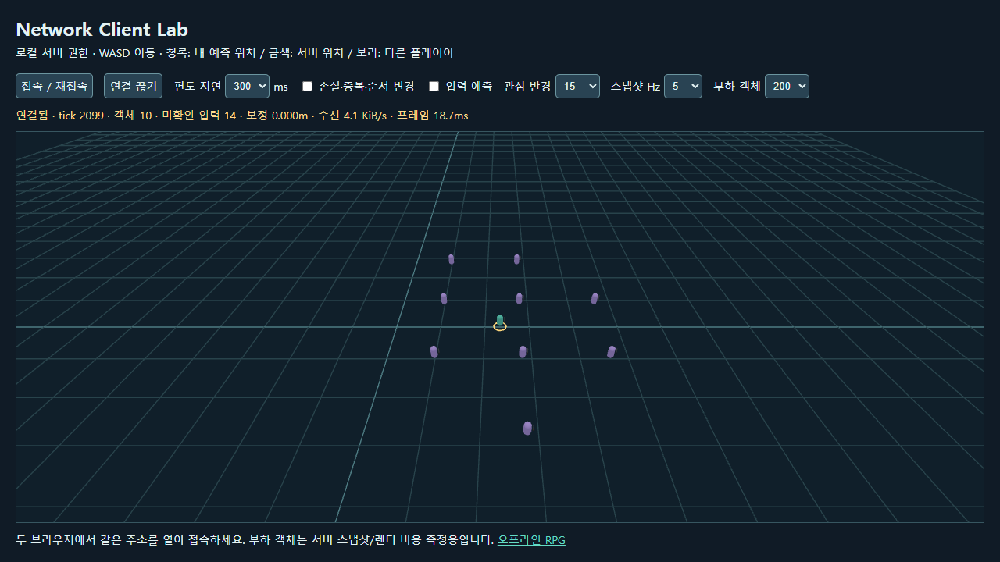

# 로컬 온라인 클라이언트 실습 A~E

## 시작

```sh
npm ci
npm run dev:network
```

`http://127.0.0.1:4173/?mode=network`를 두 브라우저 창에서 열고 각각 **접속 / 재접속**을 누른다.
캔버스를 클릭한 다음 WASD로 이동한다. 청록은 로컬 표시, 금색 고리는 서버 위치, 보라는 원격 플레이어다.
기본 RPG와 저장 데이터를 공유하지 않는다. 계정·인증·영구 저장·전투가 없는 로컬 실습이다.

| 단계 | 구현 | 직접 확인 |
| --- | --- | --- |
| A | `protocol.ts`, `FaultLink.ts`: 입력·스냅샷 계약과 결정적인 가짜 전송 큐 | 손실·중복·순서 변경을 켜도 중복 입력이 이동량을 늘리지 않음 |
| B | `World.ts`, `tools/network/plugin.ts`: 로컬 서버가 ID, 위치, tick, 장비를 소유 | 두 창에서 이동·퇴장하며 상대 객체가 생성·삭제됨 |
| C | 로컬 입력 예측·ack 이후 입력 재적용, 원격 이전/현재 스냅샷 보간 | 편도 지연 50/150/300ms에서 예측 체크를 바꿔 반응 비교 |
| D | 전체 스냅샷, 세션 재접속, 버전 확인 | 연결 끊기→재접속 시 같은 ID/서버 위치 복구, UI/장비 중복 없음 |
| E | 관심 반경 15/40/200m, 수신 5/10/20Hz, 부하 객체 0/50/200 | 수신 KiB/s, 객체 수, 프레임 ms 비교 |

## 계약과 구현 선택

브라우저 `fetch`와 Vite의 Node HTTP middleware만 사용한다. 입력은 POST, 전체 스냅샷은 주기적 GET이다.
양방향 스트림 자체보다 상태 권한·시퀀스·보정 원리를 읽기 쉽게 만드는 선택이다.
실제 MMO의 전송 방식·효율을 대표하지 않는다. 참고: [Node HTTP](https://nodejs.org/api/http.html).

- 서버는 20Hz로 진행한다. 입력은 `{seq,x,z}`이며 속도나 dt를 클라이언트에서 받지 않는다.
- 입력 생성과 전송/수신은 렌더 프레임과 별도 타이머로 실행한다. rAF만 정지해도 스냅샷과 연결 유지가 진행된다.
- 한 서버 tick에 연속 시퀀스 입력을 최대 하나만 소비한다. 순서가 바뀌면 대기하고 클라이언트는 미확인 입력을 재전송한다.
- 시퀀스 중복을 Map으로 합치고, 입력 값·최대 배치·대기 범위를 검증한다. 서버가 장비를 결정하며 localStorage는 읽지 않는다.
- 스냅샷의 ack까지 입력을 제거하고 서버 위치에서 미확인 입력을 다시 적용한다. 이전 tick 스냅샷은 버린다.
- 원격 객체는 이전/현재 위치 사이를 보간하고 초과 구간은 마지막 위치로 제한한다. 표시가 한 샘플 늦는 대신 급격한 점프를 줄인다.
- 영역을 벗어난 ID는 메시·장비를 폐기한다. 같은 ID는 기존 Group을 갱신하므로 매 스냅샷에 무기가 쌓이지 않는다.
- 명시적 퇴장은 즉시 숨긴다. 통신이 멈추면 3초 후 숨기고, 30초까지 같은 토큰으로 재접속하면 서버 상태를 복구한다. 이후에는 새 세션이다.
- 버전이 다르면 HTTP 409로 거부한다. 클라이언트는 오류를 표시하고 새로고침을 안내한다.
- 127.0.0.1·동일 출처만 허용하고 최대 64 세션, 16KiB 입력 본문으로 제한한다. 이는 운영용 인증·부정행위 방지의 대체물이 아니다.

FaultLink는 기본 편도 지연을 더하고, 오류 옵션에서는 매 7번째 묶음을 버리고 매 5번째를 복제하며 매 3번째는 추가 지연한다.
결정적인 규칙이라 같은 테스트를 반복할 수 있다. 스냅샷 손실은 HTTP 수신 뒤 적용하므로 표시된 수신 바이트는 실제 HTTP JSON 본문 기준이다.
헤더·TCP 비용은 포함하지 않는다. 부하 객체는 정적 마커이며 접속한 사용자나 AI가 아니다.

## 재현과 한계

`npm run test`는 50/150/300ms 지연·손실·순서 변경 후 최종 이동량과 ack 수렴, 중복·잘못된 입력,
퇴장·시간 만료·관심 영역을 검사한다. `npm run test:e2e`는 두 Chrome 페이지의 실제 HTTP 왕복과 화면을 검사한다.
`npm run test:perf`는 지연, 예측, 객체 수, 반경, Hz의 측정치를 JSON 첨부 파일로 남긴다.

브라우저가 백그라운드에서 타이머를 제한하면 접속 시간이 초과될 수 있다. 자동 무한 재시도 대신 재접속 버튼으로 전체 상태를 받는다.
서버 재시작 시 세션은 사라진다. 장애물 충돌·공격·인벤토리 동기화, 대규모 분산 서버, 로그인/결제는 구현하지 않는다.
계정 없는 로컬 세션 토큰은 이 실습에서만 사용한다. 프로덕션 빌드에는 이 모드와 API가 포함되지 않는다.

네트워크 실습 화면:


